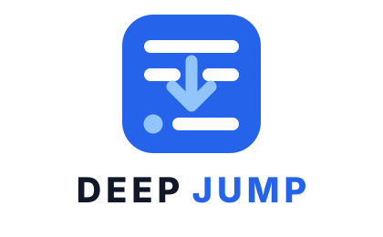

# Deep Jump (Search & Force-Scroll) for Logseq

<p align="center">
  <picture>
    <source media="(prefers-color-scheme: dark)" srcset="branding/logo-stacked-dark.svg" />
    
  </picture>
</p>

## About

When you have a journal day or page with hundreds or thousands of blocks in Logseq, clicking a search result often drops you at the top of that page instead of scrolling to your note. This happens because Logseq lazy-loads long pages and cannot scroll to a block that has not been mounted into the DOM yet.

**Deep Jump** fixes this in two ways:
- **Native `Ctrl+K` / `Cmd+K` Takeover:** Keep using Logseq's built-in search. When you click or press `Enter` on a result and Logseq leaves you at the top of the page, Deep Jump automatically takes over, expands any collapsed parent blocks, jumps to the block's estimated position, force-loads any remaining lazy chunks, centers the exact note, and briefly highlights it.
- **Dedicated Deep Jump Modal (`Ctrl+Alt+F` / `Cmd+Option+F`):** Search across all pages or just the current page and jump straight to any block.

## Features

- **Native Search Takeover (`autoRescueNavigation`, enabled by default):** Automatically rescues Logseq's built-in `Ctrl+K` / `Cmd+K` search jumps when lazy loading or collapsed parents hide the target block.
- **Deep Jump Search (`Ctrl+Alt+F` / `Cmd+Option+F` or toolbar icon):**
  - Multi-word case-insensitive search across **All Pages** (via `logseq.DB.q`) or **Current Page**.
  - **Enter**: Navigates to the page, expands collapsed parent blocks, jumps directly to the block, centers it, and highlights it.
  - **Shift + Enter**: Opens the block directly in the Right Sidebar.
- **Force-Load Whole Current Page:** Command palette action (`Deep Jump: Force-Load Whole Current Page`) to load every lazy-loaded block on the active page so native `Ctrl+F` works too.

## Build & Install (Unpacked Plugin)

1. Install dependencies and build:
   ```bash
   npm install
   npm run build
   ```
2. In Logseq Desktop:
   - Open **Settings -> Advanced -> Developer mode** (turn it ON).
   - Open **Plugins -> Load unpacked plugin**.
   - Select the cloned plugin folder (`logseq-deep-jump`).

---

## ☕ Support

If this plugin is helpful to you and you'd like to buy me a coffee:

<a href="https://www.buymeacoffee.com/ygreq" target="_blank">
  
</a>

Direct link: [buymeacoffee.com/ygreq](https://www.buymeacoffee.com/ygreq)
